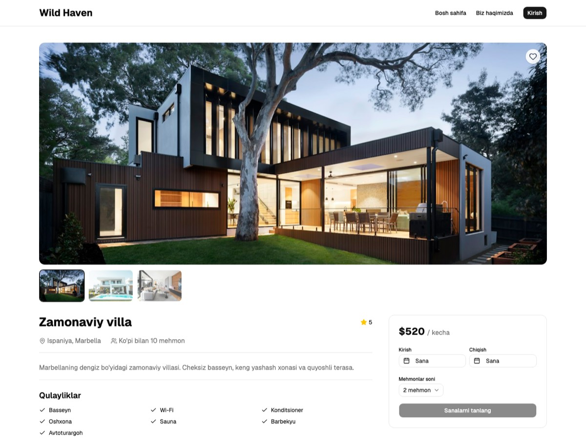

# Wild Haven 🏡

Book unique villas around the world for the dates you choose. Wild Haven is a
single-page booking app built with React, TypeScript and Supabase: browse
villas, filter and search, see which dates are taken, book a stay, save
favorites and manage your bookings.

**🔗 Live demo: https://adicorei2000-glitch.github.io/Wild-heaven/**



> The demo runs on a shared Supabase project. Bookings you make are real rows
> in that database, so please don't enter any sensitive information.

## Features

- **Browse & search** villas with text search, country, guest-count and max-price
  filters, and sorting (price, rating)
- **Villa page** with an image gallery, amenities, guest limit and live price
  calculation
- **Availability calendar**: dates that are already booked are disabled; the
  check-out day stays free for the next guest
- **Booking** with date validation and clear error messages (double bookings
  are rejected by the database)
- **Accounts**: sign up, log in, log out, forgot / reset password
- **My bookings**: list and cancel your own bookings
- **Favorites**: save villas with the heart button and see them on a separate page

## Tech stack

| Area | Tools |
| --- | --- |
| Frontend | React 19, TypeScript, Vite, React Router |
| UI | Tailwind CSS 4, shadcn/ui (Radix), lucide-react, react-day-picker |
| Backend | Supabase (Postgres, Auth, Row Level Security) |
| Tooling | Oxlint, GitHub Actions, GitHub Pages |

## Getting started

**Prerequisites:** Node.js 20.19+ (or 22.12+) and a free [Supabase](https://supabase.com) project.

```bash
git clone https://github.com/adicorei2000-glitch/Wild-heaven.git
cd Wild-heaven
npm install
cp .env.example .env     # then fill in your Supabase URL and anon key
```

**Set up the database.** Open Supabase → SQL Editor, paste the whole content of
[`supabase/setup.sql`](supabase/setup.sql) and run it. It is safe to run more than
once. It creates the `villas`, `bookings` and `favorites` tables, seeds four
sample villas, and installs the security rules described below.

**Authentication settings.** In Supabase → Authentication → URL Configuration add
your site URL and `http://localhost:5173/reset-password` to the redirect URLs, so
confirmation and password-reset emails link back to the app.

```bash
npm run dev              # http://localhost:5173
```

### Scripts

| Command | Description |
| --- | --- |
| `npm run dev` | Start the dev server |
| `npm run build` | Type-check and build for production |
| `npm run preview` | Preview the production build |
| `npm run lint` | Lint with Oxlint |

## How it works

The browser talks to Supabase directly, so the rules that matter are enforced
**in the database**, not in the UI:

- **Row Level Security**: users can only read, create and delete their own
  bookings and favorites. Villas are publicly readable.
- **No double bookings**: an exclusion constraint on `(villa_id, date range)`
  rejects overlapping stays. Check-out day is not counted as booked.
- **Server-side price**: a `BEFORE INSERT` trigger on `bookings` recalculates
  the villa name and total price from the `villas` table and checks the guest
  limit, so a tampered request can't change the price.
- **Availability without leaking data**: `get_booked_ranges(villa_id)` returns only
  date ranges (never who booked), so the calendar can show taken dates.

## Project structure

```
src/
├── components/ui/     shadcn/ui components, header, footer, villa card, favorite button
├── data/villa.ts      Villa type
├── lib/               supabase client, villas queries, useUser, useFavorites
└── pages/             Home, villa details, login, signup, forgot/reset password,
                       my bookings, favorites, about
supabase/setup.sql     Database schema, seed data and security rules
.github/workflows/     GitHub Pages deployment
```

## Deployment

Every push to `main` is built and published to GitHub Pages by
[`.github/workflows/deploy.yml`](.github/workflows/deploy.yml). The build needs two
repository secrets: `VITE_SUPABASE_URL` and `VITE_SUPABASE_ANON_KEY`
(Settings → Secrets and variables → Actions). The anon key is public by design;
access is controlled by Row Level Security. Never use the `service_role` key in
this project.

## Roadmap

- Booking status (pending / confirmed / cancelled) instead of deleting rows
- Admin panel to manage villas and bookings
- Reviews and ratings from guests who stayed
- Payments (Stripe test mode) and booking confirmation emails
- Multiple languages (uz / en / ru) and dark mode

---

## 🇺🇿 O'zbekcha qisqacha

**Wild Haven** — dunyoning turli joylaridagi villalarni kerakli sanalarga bron
qilish uchun veb-ilova. React, TypeScript va Supabase bilan yozilgan.

- Villalarni qidirish, davlat / mehmonlar soni / narx bo'yicha saralash
- Band sanalar kalendarda ko'rinadi, ikki marta bron qilib bo'lmaydi
- Ro'yxatdan o'tish, kirish, parolni tiklash
- Bronlarni ko'rish va bekor qilish, sevimli villalar

Ishga tushirish: `npm install`, `.env.example` dan `.env` yarating, Supabase'da
`supabase/setup.sql` ni ishga tushiring, keyin `npm run dev`.
