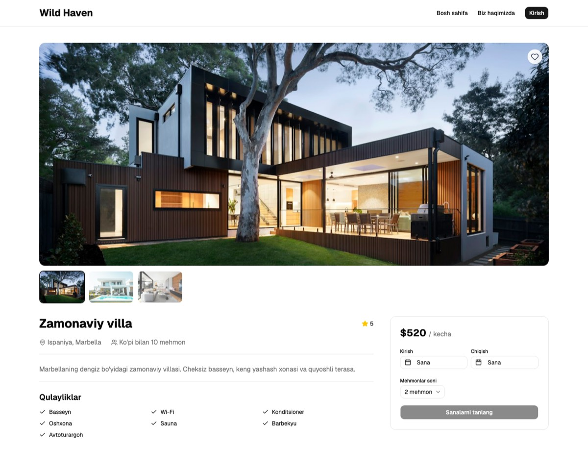

# Wild Haven 🏡

Book unique villas around the world for the dates you choose. Wild Haven is a
single-page booking app built with React, TypeScript and Supabase: browse and
search villas, see which dates are taken, book and pay for a stay, leave
reviews, and manage everything from an admin panel. The UI is available in
Uzbek, English, Russian and Korean.

**🔗 Live demo:**

[](https://wild-heaven-5f7f.vercel.app/)
[](https://adicorei2000-glitch.github.io/Wild-heaven/)

- ▲ Vercel: https://wild-heaven-5f7f.vercel.app/
- 🐙 GitHub Pages: https://adicorei2000-glitch.github.io/Wild-heaven/



> The demo runs on a shared Supabase project. Bookings you make are real rows
> in that database, so please don't enter any sensitive information. Payments
> run in **Stripe test mode**: no real money is charged. Use the test card
> `4242 4242 4242 4242`, any future expiry date and any CVC.

## Features

**For guests**

- **Browse & search** villas by text, country, guests, max price and **free dates**,
  with sorting (price, rating)
- **Villa page** with an image gallery, amenities, a location map, reviews and live
  price calculation
- **Availability calendar**: booked dates are disabled; the check-out day stays free
  for the next guest
- **Booking & payment**: a new booking holds the dates as *pending*, then the guest
  pays with Stripe Checkout and the booking becomes *confirmed* automatically
- **Booking emails** (new booking, confirmed, cancelled) in the guest's language
- **My bookings**: status badges, pay later, cancel your own bookings
- **Reviews & ratings**: only guests with a finished stay can review; the villa
  rating is the average of reviews
- **Accounts**: sign up, log in, forgot / reset password, profile (name, password)
- **Favorites**, **dark mode** and **4 languages** (uz / en / ru / ko)

**For admins** (`/admin`)

- Confirm, reject, cancel or restore bookings (with the guest's email and payment status)
- Add, edit and delete villas, upload photos and set map coordinates

## Tech stack

| Area | Tools |
| --- | --- |
| Frontend | React 19, TypeScript, Vite, React Router, i18next |
| UI | Tailwind CSS 4, shadcn/ui (Radix), lucide-react, react-day-picker, OpenStreetMap |
| Backend | Supabase (Postgres, Auth, Storage, Edge Functions, Row Level Security) |
| Payments & email | Stripe Checkout (test mode), Resend |
| Tooling | Oxlint, GitHub Actions (CI + GitHub Pages) |

## Getting started

**Prerequisites:** Node.js 20.19+ (or 22.12+) and a free [Supabase](https://supabase.com) project.

```bash
git clone https://github.com/adicorei2000-glitch/Wild-heaven.git
cd Wild-heaven
npm install
cp .env.example .env     # then fill in your Supabase URL and anon key
```

**Set up the database.** Open Supabase → SQL Editor and run these files **in order**
(each is safe to run more than once, except `setup.sql`, which should be run only
once as the first step because it creates the original base schema):

1. [`supabase/setup.sql`](supabase/setup.sql): tables, seed villas and base security rules
2. `02_booking_status.sql`: booking status and `cancel_booking()`
3. `03_more_villas.sql`: four more sample villas
4. `04_security.sql`: security fix
5. `05_admin.sql`: admin panel (`admins` table, admin policies and functions)
6. `06_booking_lang.sql`: guest language for emails
7. `07_reviews.sql`: reviews and automatic rating
8. `08_villa_coordinates.sql`: map coordinates
9. `09_availability_and_images.sql`: free-date search and villa photo storage
10. `10_payments.sql`: payment columns

**First admin.** Sign up on the site, then run in the SQL Editor (use your own email):

```sql
insert into public.admins (user_id)
select id from auth.users where email = '<ADMIN_EMAIL>'
on conflict do nothing;
```

**Edge Functions** (in [`supabase/functions`](supabase/functions)): deploy
`notify-booking`, `create-checkout` and `verify-payment`. (`stripe-webhook` is optional:
payments are verified when the guest returns to the site.) Set these in
Supabase → Edge Functions → Secrets:

| Secret | Purpose |
| --- | --- |
| `STRIPE_SECRET_KEY` | Stripe secret key (use a `sk_test_...` key) |
| `RESEND_API_KEY` | Sends booking emails via Resend |
| `ADMIN_EMAIL` | Receives "new booking" emails |
| `FROM_EMAIL` | Optional sender; without a verified domain Resend only delivers to your own address |
| `ALLOWED_ORIGINS` | Optional, comma-separated sites allowed to return from Stripe |

Without the Stripe key the site still works: bookings simply wait for an admin to
confirm them.

**Authentication settings.** In Supabase → Authentication → URL Configuration add
your site URL and `http://localhost:5173/reset-password` to the redirect URLs, so
confirmation and password-reset emails link back to the app.

```bash
npm run dev              # http://localhost:5173
```

### Scripts

| Command | Description |
| --- | --- |
| `npm run dev` | Start the dev server |
| `npm run build` | Type-check and build for production |
| `npm run preview` | Preview the production build |
| `npm run lint` | Lint with Oxlint |

## How it works

The browser talks to Supabase directly, so the rules that matter are enforced
**in the database**, not in the UI:

- **Row Level Security**: users can only read their own bookings and favorites;
  villas are publicly readable; only admins can change villas.
- **No double bookings**: an exclusion constraint on `(villa_id, date range)`
  rejects overlapping stays (pending and confirmed both hold the dates).
- **Server-side price and status**: a `BEFORE INSERT` trigger recalculates the villa
  name and total price, checks the guest limit and always starts a booking as
  *pending* without payment data, so a tampered request can't change them.
- **Payments**: the Stripe amount is read from the database, never from the browser.
  A booking is confirmed only after the server checks the session with Stripe.
- **Admin actions** go through `SECURITY DEFINER` functions that check `is_admin()`.
- **Reviews**: an insert policy only allows one review per finished, confirmed booking
  of the reviewer; a trigger keeps the villa rating up to date.
- **Availability without leaking data**: `get_booked_ranges(villa_id)` and
  `get_available_villa_ids(from, to)` return only dates / ids, never who booked.

## Project structure

```
src/
├── components/ui/     shadcn/ui components, header, footer, villa card, reviews, map
├── data/villa.ts      Villa type
├── i18n/              translations (uz, en, ru, ko), calendar locale, villa text helpers
├── lib/               supabase client, villas, reviews, payments, notify, hooks
└── pages/             Home, villa details, auth pages, my bookings, favorites,
                       profile, admin, about
supabase/              SQL files 02-10 + setup.sql, and Edge Functions
.github/workflows/     CI (lint, type-check, build) and GitHub Pages deployment
```

## Deployment

Every push to `main` is built and published to GitHub Pages by
[`.github/workflows/deploy.yml`](.github/workflows/deploy.yml). The build needs two
repository secrets: `VITE_SUPABASE_URL` and `VITE_SUPABASE_ANON_KEY`
(Settings → Secrets and variables → Actions). The anon key is public by design;
access is controlled by Row Level Security. Never use the `service_role` key in
this project.

## Roadmap

- Sign in with Google (code is ready on the `google-login` branch, needs Google OAuth setup)
- Live payments (requires a verified Stripe account)
- Confirmation email after a successful payment

---

## 🇺🇿 O'zbekcha qisqacha

**Wild Haven** — dunyoning turli joylaridagi villalarni kerakli sanalarga bron
qilish uchun veb-ilova. React, TypeScript va Supabase bilan yozilgan.

- Villalarni qidirish: davlat, mehmonlar soni, narx va bo'sh sanalar bo'yicha
- Band sanalar kalendarda ko'rinadi, ikki marta bron qilib bo'lmaydi
- Bron statusi, Stripe orqali to'lov (test rejimi), email xabarlar
- Sharhlar va reyting, xarita, sevimlilar, profil, qorong'u rejim
- 4 til: o'zbekcha, inglizcha, ruscha, koreyscha
- Admin panel: bronlarni tasdiqlash, villalarni boshqarish va rasm yuklash

Ishga tushirish: `npm install`, `.env.example` dan `.env` yarating, Supabase'da
`supabase/setup.sql` va undan keyin `02`–`10` raqamli SQL fayllarni tartib bilan
ishga tushiring, birinchi adminni qo'shing, keyin `npm run dev`. Batafsil yo'riqnoma
yuqorida (inglizcha).
